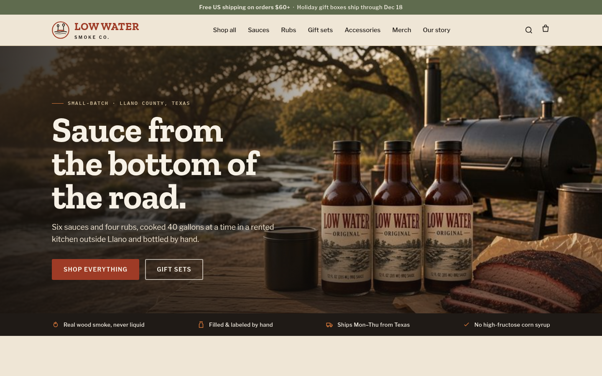

# Low Water Smoke Co. (fictional Shopify store demo)

A complete online store for a small-batch Texas BBQ sauce brand, built as a demo of what a Shopify build from [Jacobs Consultancy](https://thejacobsconsultancy.com/shopify) looks like.

**Low Water Smoke Co., its founders and its products are made up.** There is no real business behind it, and the product photos are AI-generated.

**[See the live preview](https://jc-shopify-demo.pages.dev/)**



## What's here

| Path | What it is |
|---|---|
| `brand.md` | The brand: name, story, palette with contrast checks, fonts and photography rules |
| `products.csv` | A Shopify product import file: 18 products, 30 variants, SKUs, weights, SEO fields, alt text |
| `theme-notes.md` | Step-by-step setup for Shopify's free Dawn theme, section by section |
| `public/` | A static preview of the store (home, collections, product pages) |
| `src/` | The Python scripts that generate the preview and the CSV from one product list |
| `screens/` | Desktop and mobile screenshots |

## What it shows

- **A real brand, not a template with lorem ipsum.** A name with a story, a tagline, a palette that passes WCAG AA, and copy for every page.
- **A catalogue that imports cleanly.** The CSV uses Shopify's current product headers, with variants (colour and size), compare-at prices on bundles, Standard Product Taxonomy categories and image alt text.
- **Mobile first.** Product cards, heat ratings and gift bundles designed for a phone screen before a desktop one.
- **One source of truth.** Products live in `src/products.py`; the preview site and the import CSV are both generated from it, so they can't drift apart.

## Run the preview

```bash
python3 src/build_site.py     # regenerates public/
python3 src/build_csv.py      # regenerates products.csv
python3 -m http.server -d public 8080
```

Then open http://127.0.0.1:8080.

## About

Designed and built by [Cheslin Jacobs](https://github.com/CJacobsCreates) at [Jacobs Consultancy](https://thejacobsconsultancy.com). Want a store like this for your own brand? Email [info@thejacobsconsultancy.com](mailto:info@thejacobsconsultancy.com).
